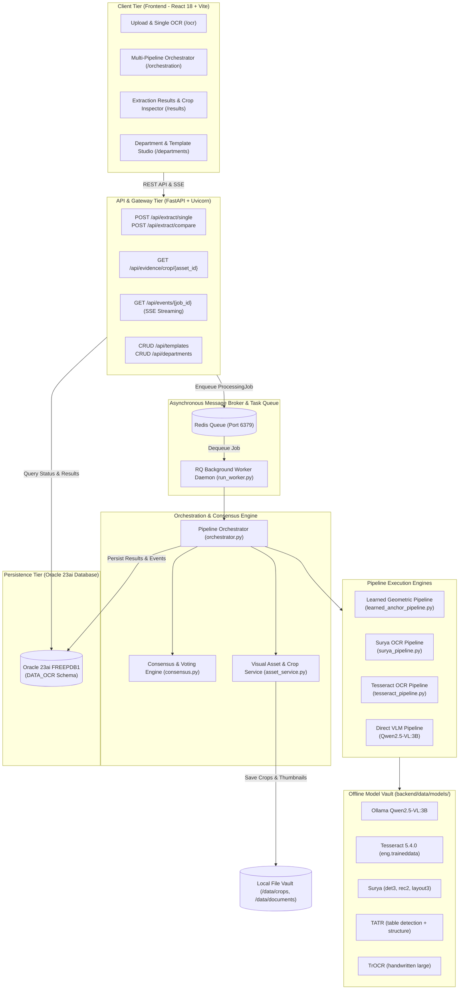
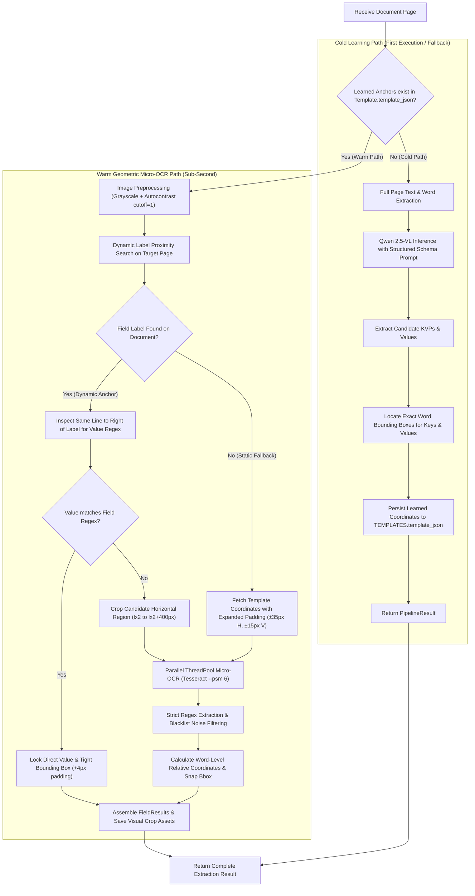
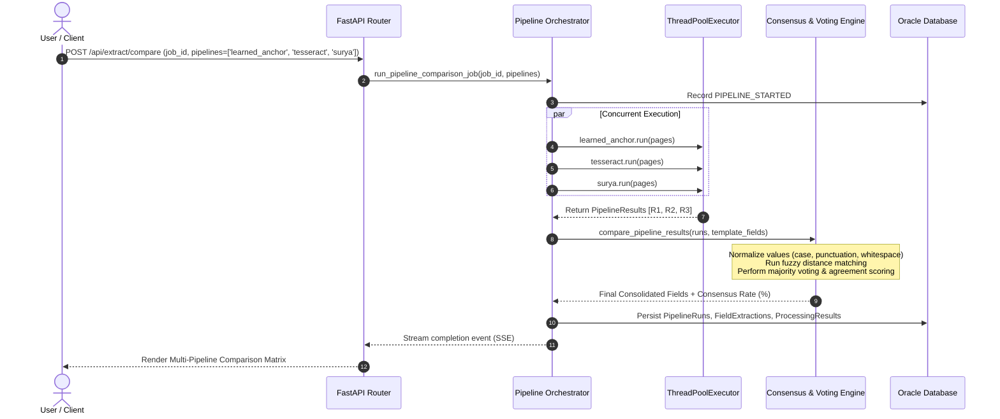
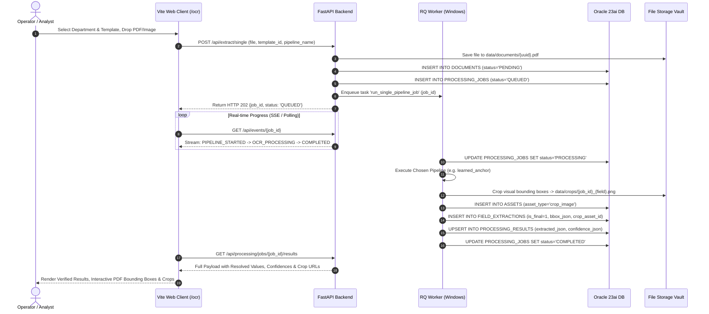

# DOCINT — System Architecture & Complete Technical Workflow Specification

> **Classification:** Technical Architecture & Systems Manual  
> **Platform Version:** DocInt 1.0.0 (Offline / Air-Gapped Ready)  
> **Target Environment:** Windows 10/11 / Windows Server, Oracle 23ai Database, Local Redis 6379, NVIDIA CUDA / Multi-Core CPU  

---

## 1. Executive Summary

**DocInt** is an enterprise- and military-grade Intelligent Document Processing (IDP) platform designed to extract high-accuracy key-value pairs (KVPs), tabular structures, and handwritten annotations from structured, semi-structured, and scanned PDF/image documents.

### Key Capabilities
- **100% Air-Gapped / Offline Operation:** Zero internet connectivity required. All OCR, transformer, and Vision-Language Models (VLMs) run locally from pre-cached disk storage and local inference runtimes.
- **Sub-Second Geometric Memory (`learned_anchor`):** Autonomous template learning that remembers document geometry. On warm hits, it executes parallel micro-region OCR in under **300ms–2s** without invoking expensive large vision models.
- **Multi-Pipeline Orchestration & Consensus Voting:** Concurrently dispatches documents across multiple distinct OCR engines (Learned Anchor, Surya, Tesseract), aligning and reconciling field values through fuzzy consensus scoring and majority voting.
- **Pixel-Accurate Visual Evidence:** Automatically generates cropped image snippets for every single extracted field and table, providing instant visual verification for auditors and data operators.

---

## 2. High-Level System Architecture



---

## 3. Deep Dive: Machine Learning & OCR Models

DocInt uses a specialized suite of localized machine learning and neural network models:

| Model Name | Framework / Architecture | Disk Location | Role in Platform | Latency / Device Profile |
| :--- | :--- | :--- | :--- | :--- |
| **Qwen2.5-VL:3B** | Multimodal Vision-Language Transformer (Alibaba / Ollama) | Local Ollama Model Storage (`localhost:11434`) | High-level semantic reasoning, cold-path layout discovery, noisy document rectification | GPU (CUDA 12/13): ~1.2s–2.5s<br/>CPU: ~8s–15s |
| **Tesseract 5.4.0** | LSTM Neural Network OCR (Google / UB Mannheim) | `C:\Program Files\Tesseract-OCR\` | High-speed printed text extraction, word-level confidence and bounding-box coordinates | CPU: ~150ms–400ms/page |
| **Surya OCR** | SegFormer / Vision Transformer (`vikp/surya_*`) | `data/models/huggingface/hub/` | Line-level polygon detection, complex reading order analysis, multi-column document extraction | CPU: ~2.5s–5.0s/page<br/>GPU: ~400ms/page |
| **Table Transformer (TATR)** | DETR (DEtection TRansformer - Microsoft) | `data/models/huggingface/hub/` (`models--microsoft--table-transformer-*`) | Deep tabular extraction: table boundary detection and table row/column structure recognition | CPU: ~1.5s–3.0s/page |
| **TrOCR Large** | Vision-Encoder-Decoder (Microsoft) | `data/models/huggingface/hub/` (`models--microsoft--trocr-large-handwritten`) | Selective handwritten cursive text recognition on low-confidence fallback fields | CPU: ~1.0s–2.0s per crop |

---

## 4. Pipeline Architectures

### 4.1. Learned Geometric Anchor Pipeline (`learned_anchor`)
The flagship sub-second pipeline designed for repetitive documents (e.g., military vehicle inspection reports, logistics manifests, invoices, certificates).



#### Key Innovations in `learned_anchor`:
1. **Dynamic Label-Anchored Proximity Localization:**
   Rather than assuming static pixel coordinates across vehicle variants (e.g. Maruti Gypsy has 17 header rows, Ashok Leyland Stallion has 24 header rows, TATA 2.5 Ton has 20 header rows), the pipeline dynamically scans for the key token (`Engine No:`, `Chassis No:`, `BA No:`) and anchors relative to where the label actually appears on *this* document.
2. **Preprocessing Filter:**
   Runs `ImageOps.autocontrast(gray, cutoff=1)` to eliminate scanner background grayness, faint carbon paper artifacts, and shadow borders.
3. **Regex Value Snapping:**
   Uses domain regex (military BA number `\d{2}[A-Z]\s*\d{5,7}[A-Z]?`, engine serials `[A-Z0-9/\-]{6,16}`, chassis VINs) to filter extraneous text. The bounding box is automatically snapped strictly to the words matching the regex, discarding adjacent labels and neighboring rows.

---

### 4.2. Surya OCR Pipeline (`surya`)
- **Stage 1 (Layout Analysis):** Runs `surya_layout3` to separate headers, footers, paragraphs, and tables.
- **Stage 2 (Line Detection):** Runs `surya_det3` to locate polygon bounding boxes for every single line.
- **Stage 3 (Reading Order & Recognition):** Re-orders lines into human reading flow and recognizes text using `surya_rec2`.
- **Stage 4 (Semantic Field Matching):** Matches template field names against clustered text blocks via Levenshtein distance and proximity indexing.

---

### 4.3. Tesseract OCR Pipeline (`tesseract`)
- **Stage 1 (Page Rendering):** Converts PDF vector pages to 150/300 DPI high-resolution bitmaps.
- **Stage 2 (Layout & Word Extraction):** Runs Tesseract 5.4 with `--psm 1` or `--psm 3` (automatic page segmentation) returning word-level bounding boxes and confidence scores.
- **Stage 3 (Table Extraction):** Dispatches detected tabular regions to Microsoft Table Transformer (`TATR`) for structural row/column reconstruction.

---

### 4.4. Multi-Pipeline Comparison & Consensus Engine
Dispatched when users execute documents through the **Multi-Pipeline Orchestrator** (`/orchestration`).



---

## 5. End-to-End Processing Workflow

### Workflow 1: Single Document Upload & Extraction (`/ocr`)



---

## 6. Oracle 23ai Database Schema & Entity Relationships

```mermaid
erDiagram
    DEPARTMENTS ||--o{ TEMPLATES : "owns"
    DEPARTMENTS ||--o{ DEPARTMENT_URLS : "hosts"
    TEMPLATES ||--o{ TEMPLATE_FIELDS : "defines"
    TEMPLATES ||--o{ DOCUMENTS : "classifies"
    TEMPLATES ||--o{ PROCESSING_JOBS : "executes"
    DOCUMENTS ||--o{ PROCESSING_JOBS : "undergoes"
    DOCUMENTS ||--o{ DOCUMENT_PAGES : "contains"
    PROCESSING_JOBS ||--o{ PIPELINE_RUNS : "dispatches"
    PROCESSING_JOBS ||--o{ FIELD_EXTRACTIONS : "extracts"
    PROCESSING_JOBS ||--o{ TABLE_EXTRACTIONS : "extracts"
    PROCESSING_JOBS ||--o| PROCESSING_RESULTS : "summarizes"
    PROCESSING_JOBS ||--o{ PROCESSING_EVENTS : "logs"

    DEPARTMENTS {
        NUMBER id PK
        VARCHAR2 name
        VARCHAR2 slug UK
        VARCHAR2 description
        NUMBER is_active
        TIMESTAMP created_at
    }

    TEMPLATES {
        NUMBER id PK
        NUMBER department_id FK
        VARCHAR2 code
        NUMBER version
        CLOB template_json
        CLOB extraction_instructions
        NUMBER is_active
    }

    TEMPLATE_FIELDS {
        NUMBER id PK
        NUMBER template_id FK
        VARCHAR2 name
        VARCHAR2 label
        VARCHAR2 field_type
        NUMBER is_required
        NUMBER confidence_threshold
        CLOB validation_rules
    }

    DOCUMENTS {
        VARCHAR2 id PK "UUID"
        VARCHAR2 original_filename
        VARCHAR2 file_path
        VARCHAR2 file_type
        NUMBER file_size_bytes
        NUMBER template_id FK
        VARCHAR2 status "CHECK (status IN ('PENDING', 'QUEUED', 'PROCESSING', 'COMPLETED', 'WARNING', 'FAILED'))"
    }

    PROCESSING_JOBS {
        VARCHAR2 id PK "UUID"
        VARCHAR2 document_id FK
        NUMBER template_id FK
        VARCHAR2 status "CHECK (status IN ('QUEUED', 'PROCESSING', 'OCR_PROCESSING', 'AI_PROCESSING', 'VALIDATING', 'COMPLETED', 'WARNING', 'FAILED'))"
        NUMBER overall_confidence
        NUMBER duration_ms
        TIMESTAMP started_at
        TIMESTAMP completed_at
    }

    FIELD_EXTRACTIONS {
        VARCHAR2 id PK "UUID"
        VARCHAR2 job_id FK
        VARCHAR2 pipeline_run_id FK
        VARCHAR2 field_name
        CLOB field_value
        NUMBER confidence
        VARCHAR2 extraction_method
        VARCHAR2 fallback_method "needs_review"
        CLOB bbox_json
        NUMBER is_final
    }

    PROCESSING_RESULTS {
        NUMBER id PK
        VARCHAR2 job_id FK UK
        CLOB extracted_json
        CLOB confidence_json
        CLOB ocr_metadata_json
    }

    ASSETS {
        VARCHAR2 id PK "UUID"
        VARCHAR2 asset_type "crop_image | thumbnail"
        VARCHAR2 file_path
        VARCHAR2 mime_type
        TIMESTAMP created_at
    }
```

---

## 7. Storage & File System Layout

```
OCR_final/
├── backend/
│   ├── app/
│   │   ├── ai/                        # AI & LLM Orchestration
│   │   │   ├── consensus.py           # Multi-pipeline agreement & voting logic
│   │   │   ├── ollama.py              # Ollama API client (Qwen2.5-VL:3B)
│   │   │   ├── orchestrator.py        # Central AI inference dispatcher
│   │   │   └── prompt_builder.py      # Schema-driven dynamic prompt synthesis
│   │   ├── api/routes/                # FastAPI Endpoints
│   │   │   ├── extract.py             # Ingestion & pipeline dispatch
│   │   │   ├── evidence.py            # Crop image rendering & retrieval
│   │   │   ├── events.py              # Server-Sent Events (SSE) progress streams
│   │   │   ├── processing.py          # Job status & result querying
│   │   │   └── templates.py           # Template CRUD & geometry definition
│   │   ├── db/                        # Oracle Database Layer
│   │   │   ├── database.py            # SQLAlchemy engine, session maker, connection pool
│   │   │   └── models/core.py         # SQLAlchemy ORM entity models
│   │   ├── ocr/                       # Low-level OCR & Preprocessing Engines
│   │   │   ├── tesseract.py           # Pytesseract wrapper & word extractor
│   │   │   ├── tatr_engine.py         # Microsoft Table Transformer integration
│   │   │   └── handwriting_ocr.py     # Microsoft TrOCR handwriting fallback
│   │   ├── pipelines/                 # Pipeline Implementations
│   │   │   ├── base.py                # Abstract OCRPipeline & FieldResult interfaces
│   │   │   ├── registry.py            # Dynamic runtime pipeline discovery registry
│   │   │   ├── learned_anchor_pipeline.py # Sub-second geometric anchor pipeline
│   │   │   ├── surya_pipeline.py      # Surya OCR pipeline
│   │   │   └── tesseract_pipeline.py  # Tesseract OCR pipeline
│   │   └── services/
│   │       ├── orchestrator.py        # Single and comparison job runners
│   │       └── asset_service.py       # Visual crop clipping & filesystem storage
│   ├── data/
│   │   ├── crops/                     # Saved PNG crops of extracted field regions
│   │   ├── documents/                 # Uploaded PDF and image files
│   │   └── models/                    # Offline Pre-cached ML Models
│   │       └── huggingface/hub/       # TrOCR, Surya, TATR model weights & snapshots
│   ├── run_worker.py                  # RQ Worker daemon for background jobs
│   └── venv/                          # Active Python virtual environment
├── frontend/
│   ├── src/
│   │   ├── pages/
│   │   │   ├── OcrPage.jsx            # Single OCR upload & live execution view
│   │   │   ├── OrchestrationPage.jsx  # Multi-pipeline consensus matrix & disagreement view
│   │   │   └── ExtractionResultsPage.jsx # Historical extractions and crop inspector
│   │   └── components/
│   │       ├── ExtractionResultView.jsx # Field viewer with source crop drawer
│   │       └── PdfViewer.jsx          # PDF.js renderer with interactive bounding boxes
│   └── public/
│       └── pdf.worker.min.js          # Offline PDF.js web worker bundle
└── ARCHITECTURE_AND_WORKFLOW.md        # This specification document
```

---

## 8. Operational Quick Reference

### Starting the Platform
```powershell
# 1. Start Oracle Database & Local Redis
# (Ensure Oracle FREEPDB1 is up on port 1521, Redis on port 6379)

# 2. Start the Backend API (from backend/ directory)
cd backend
python -m uvicorn app.main:app --reload --port 8000

# 3. Start the Background Task Worker (from backend/ directory)
cd backend
python run_worker.py

# 4. Start the Frontend Development Server (from frontend/ directory)
cd frontend
npm run dev
```

### Accessing the Web Application
- **Main Platform:** `http://localhost:5173/`
- **Single OCR & Fast Geometric Path:** `http://localhost:5173/ocr`
- **Multi-Pipeline Orchestrator:** `http://localhost:5173/orchestration`
- **Interactive OpenAPI Documentation:** `http://localhost:8000/docs`
